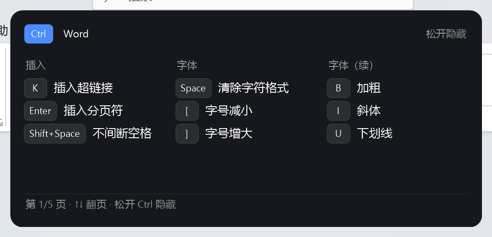

# HotkeyHud

> 按住 Ctrl 半秒，看见这个应用所有能按的快捷键。



快捷键记不住是常态，查文档要切窗口，查完还得回来。HotkeyHud 把答案放在你手边：按住修饰键，当前应用的键位表浮在窗口上方，松开就消失——不抢焦点、不挡鼠标、不改变任何应用的行为。


---

## 为什么

快捷键是「用得越多越记得住，越记不住越不敢用」的东西。Word 有 26 个 Ctrl 组合，VS Code 有 27 个，浏览器有 20 多个——没人会背。

现有做法都别扭：翻文档要离开当前窗口；看菜单要点开找；记便签贴在屏幕边上又会挡东西。

HotkeyHud 只做一件事：**在你按修饰键的那半秒，把当前应用的键位表递到你眼前，然后消失。**

---

## 特性

- **只显示当前应用**：Word 里不会出现 Chrome 的键位，靠前台进程名匹配
- **不抢焦点**：面板出现时你还能继续打字，切到别的窗口它自己收起
- **点击穿透**：鼠标点在面板上会落到下面的窗口
- **分页浏览**：`↑` `↓` 翻页，面板可见期间这两个键不传给前台应用
- **按组归类**：插入 / 字体 / 段落……同一组连续排列，不按字母乱序
- **7 个应用 + 系统快捷键**：Word / Chrome / Edge / VS Code / 文件资源管理器 / 记事本 / Windows 通用键，全部来自官方文档
- **能读出你改过的键位**：VS Code 的 `keybindings.json`、JetBrains 的 `keymaps/*.xml` 里你自己加的组合
- **常驻 12.9 MB 私有内存、空载 CPU 0.16%**、冷启动 243 ms、面板渲染 p95 9–13 ms
- **零第三方依赖**：单文件 111 MB（含 .NET 运行时，不需要预装），不联网

---

## 快速开始

```
1. 解压 HotkeyHud.zip（整个文件夹，HotkeyHud.App.exe 要和 Data 文件夹放一起）
2. 双击 HotkeyHud.App.exe —— 不弹窗，直接进托盘
3. 打开任意应用，按住 Ctrl 半秒
```

> 托盘图标可能被折叠到任务栏右下角的 `^` 里。Windows 11 默认折叠新程序的图标。

> **未签名**：首次运行 Windows 会提示「已保护你的电脑」，点「更多信息 → 仍要运行」。
> 原因与扫描结果见下方「已知限制」。

翻页：面板可见时按 `↑` / `↓`。收起：松开修饰键。

---

## 支持的应用

| 应用 | Ctrl 面板条数 | 来源 |
|---|---|---|
| Word | 26 | [微软官方快捷键页](https://support.microsoft.com/en-us/office/keyboard-shortcuts-in-word-95ef89dd-7142-4b50-afb2-f762f663ceb2) |
| Chrome | 21 | [Google 官方](https://support.google.com/chrome/answer/157179) |
| Edge | 28 | [微软官方](https://support.microsoft.com/zh-cn/microsoft-edge/microsoft-edge-键盘快捷方式-d356f99b-7fb4-7a30-f837-c5a35fd7cd1d) |
| VS Code | 27 | [官方默认键位表](https://code.visualstudio.com/docs/reference/default-keybindings) |
| 文件资源管理器 | 17 | [微软官方](https://support.microsoft.com/en-us/windows/keyboard-shortcuts-in-windows-dcc61a57-8ff0-cffe-9796-cb9706c75eec) |
| 记事本 | 12 | 同上页面的文本编辑章节 |
| 系统通用键 | 64 | 同上页面 + 通用编辑键 |

微信 / QQ / 网易云音乐 / 豆包**没有内置档案**：这四家没有官方快捷键文档，应用内设置页又要登录才能进。需要你自己加（见下一节）。

---

## 自己加应用

### 路径一：托盘 →「添加应用快捷键…」

选一个 `.exe`：

- **VS Code / JetBrains**：自动读出**你改过**的键位，直接生成档案（内置默认键位读不到，那是应用本身的限制）
- **其他应用**：生成带注释的模板并打开，照着填

### 路径二：托盘 →「设置…」

左边选应用，右边改条目。内置档案只读，第一次保存会自动复制到你的目录。键位不用手打——点键位框，直接按 `Ctrl+Alt+F` 就填进去了。

### 路径三：手写 JSON

放到 `%APPDATA%\HotkeyHud\apps\`，文件名 = 进程名（去掉 `.exe`）：

```jsonc
// %APPDATA%\HotkeyHud\apps\notepad.json
{
  "app": "notepad",
  "displayName": "记事本",
  "processNames": ["notepad.exe"],
  "shortcuts": [
    { "keys": "Ctrl+Q", "action": "退出", "group": "自定义" },
    { "keys": "Ctrl+F", "action": "我的查找", "group": "查找", "color": "#4C8DFF" }
  ]
}
```

| 字段 | 说明 |
|---|---|
| `keys` | `Ctrl` / `Alt` / `Shift` / `Win` 用 `+` 连接；空格键写 `Space` |
| `action` | 显示的动作描述，建议 ≤ 6 个汉字 |
| `group` | 面板里的分组名，不写归入「常规」 |
| `color` | 可选，只接受 7 个预设：`#4C8DFF` `#FF9F45` `#3DDC97` `#4CC9F0` `#B388FF` `#FF7EB6` `#FF6B6B` |

改完：托盘 →「重载数据」。写错了不会崩，托盘会提示哪份档案没读进来。

还有一个 `%APPDATA%\HotkeyHud\apps\_global.json`：里面的条目对**所有应用**可见。

---

## 配置

`%APPDATA%\HotkeyHud\config.json`（首次运行自动生成）：

| 字段 | 默认 | 范围 | 说明 |
|---|---|---|---|
| `dwellMs` | `450` | 80–5000 | 长按阈值（毫秒）。嫌弹得慢就调小 |
| `knownShortcuts` | `null` | `null` / `[]` / 数组 | `null` 用内置通用键名单；`[]` 关闭过滤；非空完全替换 |
| `extraGameProcesses` | `[]` | 进程名数组 | 额外要抑制的进程（游戏 / 全屏应用） |
| `startWithWindows` | `false` | 布尔 | 开机自启，托盘菜单里改更稳 |

改完要「重载数据」或重启。值写越界会被钳到边界并弹气泡，不会静默改掉。

---

## 从源码构建

```bash
git clone <this-repo>
cd HotkeyHud
dotnet build HotkeyHud.slnx -c Release
dotnet run --project src/HotkeyHud.App
```

需要 .NET 10 SDK。打包发布版：`build-release.ps1`（默认不压缩单文件；加 `-Compress` 出 49 MB 压缩版，代价是常驻内存 13 → 52 MB）。

验收套件（Debug 构建才有）：

```bash
dotnet run --project tests/HotkeyHud.Tests                    # 规则用例
dotnet run --project src/HotkeyHud.App -- --selftest          # 覆盖窗硬指标
dotnet run --project src/HotkeyHud.App -- --integration-test  # 注入按键全链路
dotnet run --project src/HotkeyHud.App -- --render-gallery --out=out
```

---

## 已知限制

**这 8 条不是 bug，是边界。** 前 3 条最容易被当成 bug 来报：

| # | 限制 | 说明 |
|---|---|---|
| 1 | **提权窗口不响应** | 以管理员身份运行的程序（任务管理器等）在前台时不弹——Windows 的 UIPI 不允许普通进程读取这类窗口的输入。要么以管理员身份运行本工具，要么放弃那个窗口 |
| 2 | **微信 / QQ / 网易云 / 豆包无档案** | 无官方文档、设置页需登录。自己加（见上） |
| 3 | **面板可见期间 `↑` `↓` 被吞** | 这两个键用来翻页，不传给前台应用。面板收起后立刻恢复 |
| 4 | 独占全屏 / 无边框全屏不显示 | 游戏、全屏视频、演示模式下不弹，这是有意的 |
| 5 | 内置档案只有 7 个应用 | 见「支持的应用」 |
| 6 | 副屏混合 DPI 未验证 | 单屏已验证；双屏不同缩放的实际效果未测 |
| 7 | 不支持 `Fn` | 键盘固件层处理，Windows 收不到这个键 |
| 8 | 设置页改过的应用不跟随内置升级 | 一旦保存过某应用的条目，之后内置更新不会流到你的副本 |

另外两条与能力有关：

- **只显示，不执行**：面板不会替你按快捷键，也不会启动程序
- **读不到应用的默认键位**：只能读到应用自己存成文件的自定义键位

### 关于签名

**当前版本未做代码签名**（证书约 ¥1000–2000/年，个人项目暂未购买）。

这会让 SmartScreen 首次运行拦一次，而且本工具的特征组合（全局键盘监听 + 开机自启 + 置顶透明窗口）正是杀软启发式引擎的键盘记录器画像。它**不联网、不写按键日志**——只有 `RawInputSource` 一处读取按键，读完只用于查表显示。

Microsoft Defender（病毒库 2026-11-20）对发布包扫描结果：`found no threats`。

---

## 与其他工具的区别

| | HotkeyHud | PowerToys Shortcut Guide | Keyviz |
|---|---|---|---|
| 触发方式 | 按住修饰键 | `Win+Shift+?` 或长按 `Win` | 常驻显示 |
| 只显示当前应用 | ✅ | ✅（需 manifest） | ❌ |
| 不抢焦点 | ✅ | 部分 | ✅ |
| 读用户自定义键位 | ✅ VS Code / JetBrains | ❌ | ❌ |
| 按键分组归类 | ✅ | ❌ | ❌ |
| 平台 | Windows | Windows | 跨平台 |

三者解决的是不同问题：Shortcut Guide 列 Windows 自己的键，Keyviz 展示你正在按什么，HotkeyHud 告诉你这个应用能按什么。

---

## 许可

[MIT](LICENSE)。欢迎 issue / PR。

内部开发文档（阶段提示词、验收记录）在 [`docs/internal/`](docs/internal/)，产品规格在 [`docs/shortcut-display-spec.md`](docs/shortcut-display-spec.md)，开发日志在 [`docs/dev-notes.md`](docs/dev-notes.md)。
